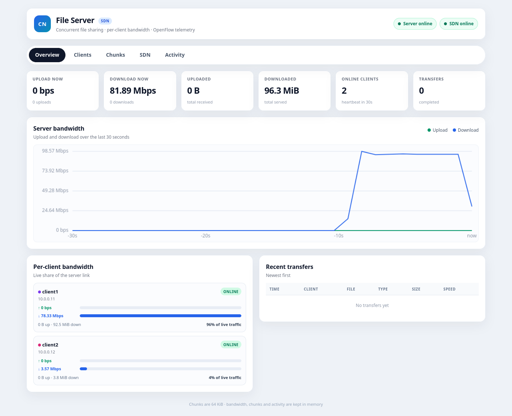
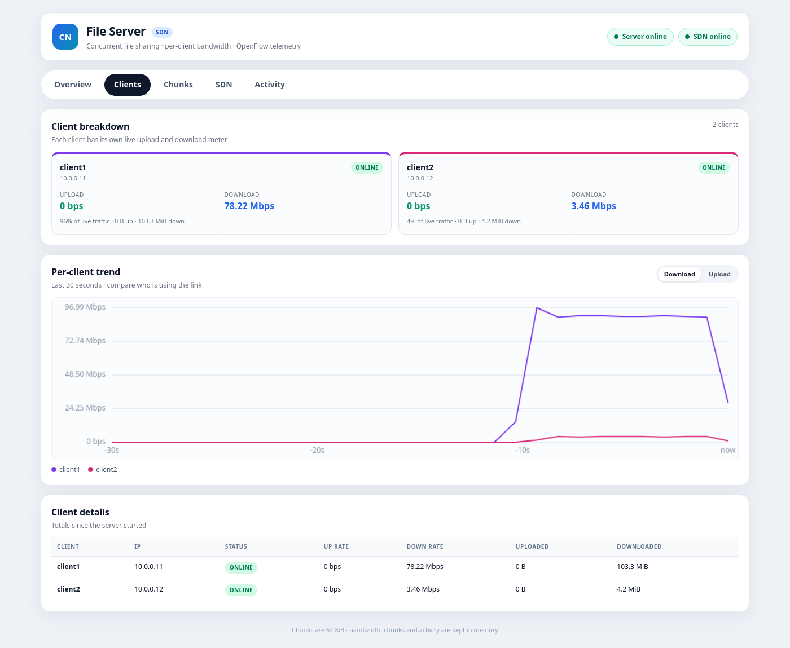
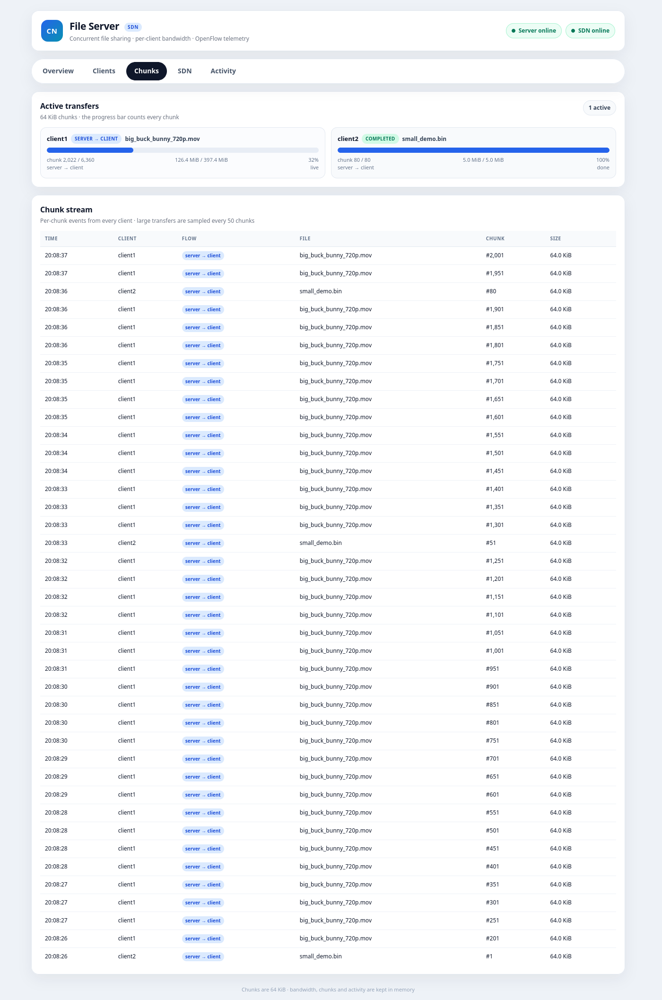
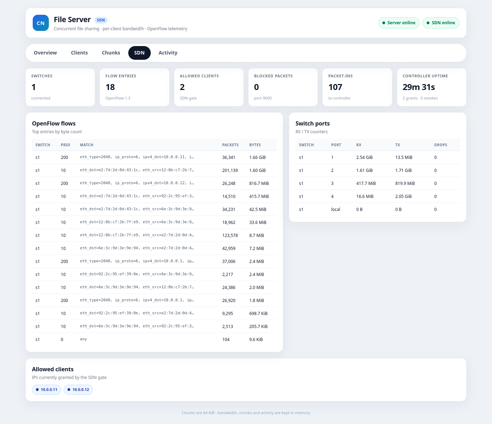
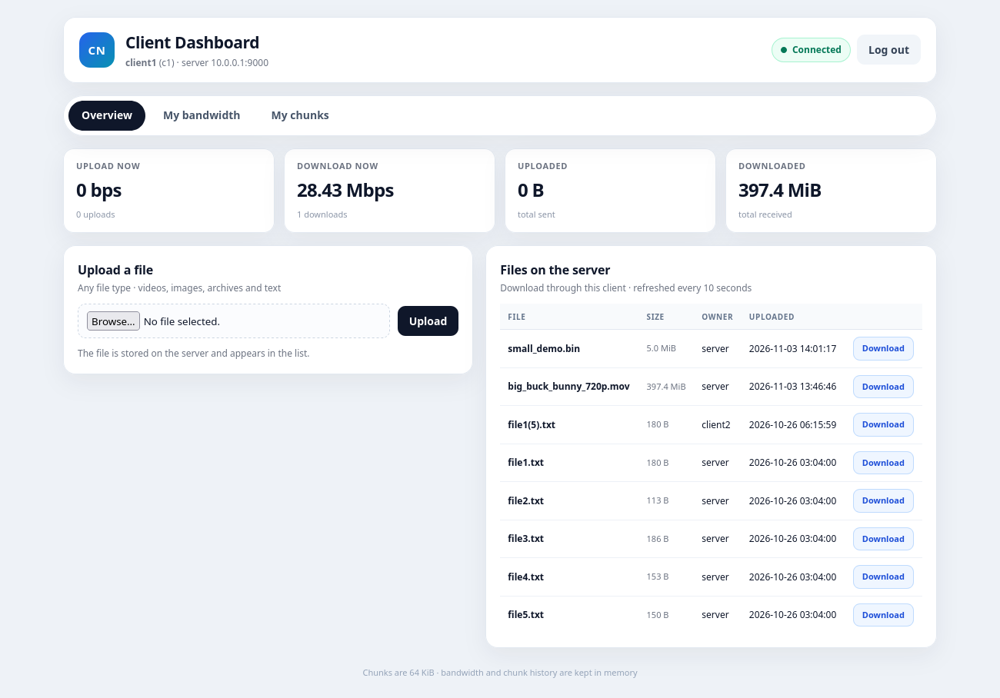
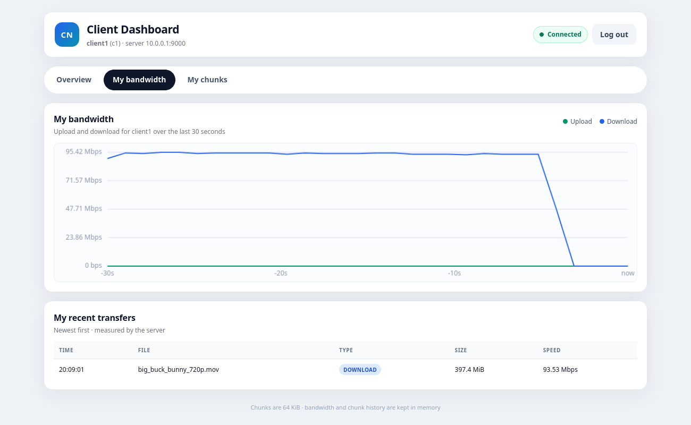
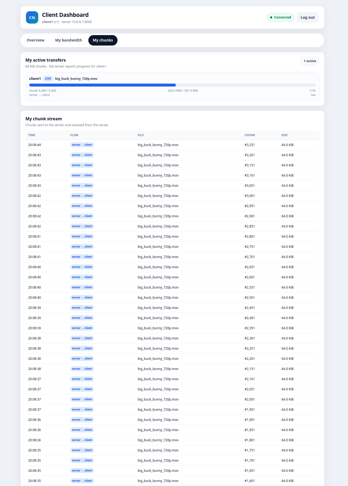

# Project 14 - Concurrent File Sharing System with SDN

This project demonstrates concurrent file transfer between one server and two
clients over TCP in a simulated Mininet network. A Ryu SDN controller controls
who can access the server, while live dashboards show per-client bandwidth,
chunk progress, and OpenFlow statistics.


https://github.com/user-attachments/assets/632f4aa7-2199-4d2a-b3bf-591dd5835e45


## Objectives

The project demonstrates how an application-layer file-sharing service can run
on top of a small software-defined network. The main objectives are to:

- Build a concurrent TCP file server that can serve several clients at once.
- Require a password before a client can use the file service.
- Support upload, download, listing and integrity checking for any file type.
- Use Mininet to create a realistic network with one server and two clients.
- Use Ryu and OpenFlow to allow or block access to the file service.
- Show live per-client bandwidth, transfer progress and chunk activity.
- Expose OpenFlow flow-table and port statistics from the controller.
- Demonstrate bandwidth contention when two clients share one bottleneck.
- Keep the dashboards clean and easy to understand during a live demo.

## Functionality

- **Password login** - the client dashboard logs in with the shared server
  password. The server then asks the SDN controller to allow that client's IP.
- **Upload and download** - clients can upload files to the server and download
  files from the server's shared storage.
- **Any file type** - transfers are binary, so videos, images, PDFs, archives
  and text files all work without extension-specific handling.
- **Concurrent clients** - the server creates a thread for every connection and
  uses locks to protect shared metadata and filename reservations.
- **Chunked transfers** - files move in 64 KiB chunks. Uploads use a temporary
  `.part` file and are published only after the complete file arrives.
- **Integrity checks** - the server checks the SHA-256 of an upload before
  publishing it, and the client checks the size and SHA-256 of a download.
- **CSV metadata** - filename, size, owner and UTC upload time are stored in
  `server/metadata.csv` and returned to clients as JSON.
- **Per-client bandwidth** - the server records totals, current rates, a
  30-second history and recent transfers for each TCP login name.
- **Chunk telemetry** - the server tracks active transfers, progress and a
  sampled chunk stream for both uploads and downloads.
- **Server dashboard** - tabs for Overview, Clients, Chunks, SDN and Activity.
- **Client dashboard** - each client sees only its own bandwidth and chunks.
- **SDN gate** - the controller blocks TCP port 9000 until a client logs in and
  removes the rules again on logout.
- **OpenFlow statistics** - the controller polls flow and port counters and the
  server dashboard shows them through the controller's `/stats` API.

## Project Architecture and Design

### Network design

```
client1 10.0.0.11 ─┐
client2 10.0.0.12 ─┼── s1 (OpenFlow switch) ── server 10.0.0.1
mgmt    10.0.0.254 ─┘             │
                                  └── Ryu controller :6653 / :8080
```

The server runs the TCP file service on port 9000 and its Flask dashboard on
port 5000. Each client runs its own Flask dashboard on port 5001. The
management address `10.0.0.254` is added to the switch so a browser on the host
can reach the Mininet addresses.

The link between the switch and the server is limited to 100 Mbps. Both client
downloads share that link, which makes bandwidth contention visible in the
per-client meters. The controller connects to the switch over OpenFlow on port
6653 and exposes a small control/stats API on port 8080.

### Design decisions

- **Framed protocol.** Every message has a fixed magic value, a header length,
  a JSON header and an optional binary payload. This keeps commands, metadata
  and file bytes separate and easy to parse.
- **Thread per connection.** A new thread handles each client, so a slow
  upload or download does not block other clients. Shared metadata and
  filename reservations are protected with locks.
- **Temporary uploads.** Incoming data goes to a UUID-named `.part` file. The
  file is renamed into place only after the full size and hash are verified, so
  incomplete uploads never appear in the file list.
- **One identity for statistics.** Bandwidth and chunk data are keyed by the
  TCP login username. Each client dashboard filters the server data with its
  own `CLIENT_NAME`, so clients cannot see each other's traffic.
- **In-memory telemetry.** Bandwidth totals, rates, history, recent transfers,
  chunk events and activity are intentionally in memory. They reset when the
  server restarts and the activity feed clears when the page reloads.
- **A real bottleneck.** The 100 Mbps server link is deliberate. It makes the
  difference between a large download and a small competing download visible
  instead of hiding contention behind an unrealistically fast link.
- **SDN enforcement at the edge.** The controller does not inspect file
  contents. It simply allows or blocks the TCP service port for each client IP,
  which keeps the gate small and easy to demonstrate.

## Contributions

### Joshua Raj

- Built the SDN and dashboard side of the project: the Ryu controller, the
  OpenFlow gate, the Mininet topology and the Flask integration.
- Set up OpenFlow rules that block TCP port 9000 until a client logs in and
  remove them when the client logs out.
- Added the controller's control API and OpenFlow statistics collection,
  including flow-table formatting, port counters, packet-in events and blocked
  request counters.
- Built the server dashboard and client dashboards, including the tabbed
  layout, per-client bandwidth meters, chunk views, SDN view and activity feed.
- Connected the Flask apps to the TCP server and controller APIs, and handled
  the live polling, filtering and proxy endpoints.
- Integrated and tested the full stack in Mininet, including the 100 Mbps
  bottleneck and the two-client contention demonstration.

### Jayasheel

- Developed the Python TCP server backend for the concurrent file-sharing
  system, including socket setup, connection handling and request/response
  processing.
- Implemented concurrent client handling with one thread per connection and
  locks around shared metadata and filename reservations.
- Added password-based authentication and rejected clients that did not
  authenticate before using file operations.
- Implemented uploads with filename validation, a 1 GiB size limit, 64 KiB
  chunks, UUID-based `.part` files and atomic publication with `os.replace`.
- Implemented downloads with file checks, size transmission and chunked binary
  transmission.
- Built CSV metadata management for filename, size, owner and UTC upload time,
  including creation, lookup, listing, newest-first sorting and locked writes.
- Switched the LIST response to a JSON array so the client receives all
  metadata records in one structured response.
- Added validation and error handling for unsupported commands, invalid
  filenames, incomplete transfers, connection failures and unexpected errors.
- Used Python sockets, threading, CSV, JSON, `os`, `pathlib`, `uuid` and
  `datetime` to implement the backend.

### Joel

- Developed the client-side transfer system in `client/client.py` and its
  integration with the shared protocol.
- Implemented the client connection lifecycle, username/password login,
  password hashing, authentication tokens and automatic re-authentication.
- Added file listing, upload and download operations using 64 KiB chunks and
  the project's custom application-layer protocol.
- Added SHA-256 integrity verification and size checks for downloads, plus
  detection of corrupted or incomplete transfers.
- Used Python threading to support parallel transfers and recorded file size,
  transfer duration and speed for each operation.
- Built the command-line interface with `argparse`, including `ls`, `put` and
  `get` commands, configurable host/credentials and parallel transfer options.
- Used Python sockets, `hashlib`, `threading`, `argparse`, `json`, `os` and
  `time` to make the client reliable and easy to use.

## Screenshots

The screenshots below were captured from the running Mininet/Ryu stack while a
large video download on client1 was competing with a smaller download on
client2.

### Server overview



The server overview shows the shared 100 Mbps link, total traffic, the live
per-client meters and the client details table.

### Server clients



The Clients tab breaks the traffic down by client and makes the bandwidth
split visible during contention.

### Server chunks



The Chunks tab shows transfer progress and the sampled chunk stream for both
uploads received by the server and downloads sent by the server.

### Server SDN statistics



The SDN tab shows the switch, flow table, port counters and packet-in activity
reported by Ryu.

### Client overview



A client dashboard shows the file list, upload form and only that client's
traffic.

### Client bandwidth



The client bandwidth view shows the 30-second trend and recent transfers for
the logged-in client.

### Client chunks



The client chunk view shows live progress and chunk events for its own
transfers.

## Login and the SDN rules

The server has one shared password, set in `server/tcp_server.py` or with the
`SERVER_PASSWORD` environment variable. The default is `pass123`.

When you submit the password on a client dashboard:

1. The client app sends it to the server (`POST /api/login`).
2. The server checks the password and tells the Ryu controller to grant the
   client's IP.
3. The controller installs these rules:

```
priority 200  tcp, src=10.0.0.11, dst=10.0.0.1, dport=9000  -> NORMAL
priority 200  tcp, src=10.0.0.1, dst=10.0.0.11, sport=9000  -> NORMAL
```

Logging out tells the controller to delete them, so the client is blocked
again.

The controller runs in the root namespace, but the Flask server runs inside the
`server` host. That is why the control API listens on all interfaces and the
server calls it at `http://10.0.0.254:8080`. You can also call it by hand:

```bash
curl -X POST localhost:8080/grant  -d '{"ip":"10.0.0.11"}'
curl -X POST localhost:8080/revoke -d '{"ip":"10.0.0.11"}'
curl localhost:8080/state
curl localhost:8080/stats
```

## Setup

Two environments are needed because Ryu does not work on newer Python
versions.

```bash
python3 -m venv .venv
.venv/bin/pip install -r requirements.txt

uv venv --python 3.8 envs/ryu
envs/ryu/bin/python -m ensurepip --upgrade
envs/ryu/bin/python -m pip install "setuptools<58" wheel
envs/ryu/bin/python -m pip install --no-build-isolation ryu==4.34
envs/ryu/bin/python -m pip install --no-build-isolation eventlet==0.30.2 greenlet==1.1.3
```

Mininet must already be installed (`sudo mn --test pingall`).

## Run

Open three terminals in the project folder.

```bash
envs/ryu/bin/ryu-manager SDN/controller.py
```

```bash
sudo env SDN_CONTROLLER_IP=127.0.0.1 python3 SDN/topology.py
```

Stop with Ctrl-C in the topology terminal, then run `sudo mn -c`.

The applications run inside the Mininet hosts. If the Ryu command says
`No such file or directory`, check that you are in the project folder and that
`envs/ryu` exists (it is not stored in git).

## Dashboards

- server: <http://10.0.0.1:5000>
- client1: <http://10.0.0.11:5001>
- client2: <http://10.0.0.12:5001>

The management interface `10.0.0.254` is added by the topology so the browser
can reach these addresses.

The server dashboard has a live overview, per-client meters, per-client trend
charts, a client details table, chunk progress, OpenFlow statistics and an
activity feed. The activity feed is kept in memory only: it clears when the page
is reloaded and when the server restarts.

The client dashboard shows only that client's own traffic. It uses the
`CLIENT_NAME` environment variable as the filter, so `client1` sees `client1`
and `client2` sees `client2`.

## Using the dashboards

1. Open a client dashboard, for example <http://10.0.0.11:5001>.
2. Log in with the server password (`pass123` by default).
3. Upload a file or download one from the list.
4. Open **My bandwidth** or **My chunks** to watch the transfer.
5. Press **Log out** to revoke access.

The client is online while its heartbeat can reach the server, which means it
is logged in.
